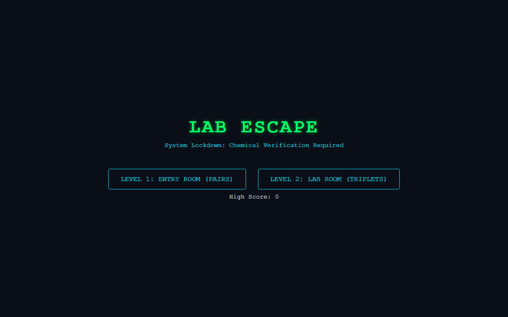

# 🧪 Lab Escape — Cyberpunk Chemical Memory Browser Game

**Lab Escape** is a browser-based memory puzzle game set in a quarantined research facility. Players must decipher chemical formulas, compound names, and everyday uses to unlock security sectors before time runs out.



---

## 🎮 How to Play & Run

### Play Instantly
- **Browser:** Simply open `index.html` directly in any modern desktop or mobile browser (Chrome, Edge, Firefox, Safari).
- **Online Demo:** Play the live build included in the [Developer Portfolio](https://github.com/Sturdyshownolove/portfolio) under `Labescape/index.html`.

### Game Rules
1. **Sector 1 (Pairs):** Match chemical formulas with their common names (e.g., `NaCl` ↔ `Yemek tuzu`).
2. **Sector 2 (Trios):** Match 3-card sets containing chemical formulas, traditional names, and household locations (e.g., `HCl` ↔ `Tuz ruhu` ↔ `Temizlik dolabında`).
3. **Timer & Scoring:** Fast consecutive matches earn maximum points (up to 100 pts per set, with a 10 pt floor). High scores are saved locally in `localStorage`.

---

## ✨ Features

- **Progressive Difficulty:** 2-card matching grid (4x4) advancing to multi-item 3-card sets (4x3).
- **Procedural Audio Synthesizer:** Built with the **Web Audio API** — synthesizes custom sound effects (sine, triangle, and sawtooth waves) dynamically without external audio files.
- **Cyberpunk UI Theme:** Dark neon palette, glitch styling, and responsive layout.
- **Automated Test Suite:** Pure game logic covered by automated unit tests.

---

## 🧪 Running Automated Tests

The game engine includes unit tests covering card generation, Fisher-Yates shuffling, matching algorithms, and score calculations using Node.js:

```bash
npm test
# Or directly via Node.js built-in test runner:
node --test tests/game.test.js
```

---

## 🛠 Tech Stack

- **Frontend:** Vanilla JavaScript (ES6+), HTML5, CSS3
- **Audio:** Web Audio API (`AudioContext`, `OscillatorNode`, `GainNode`)
- **Persistence:** Browser `localStorage`
- **Testing:** Node.js Native Test Runner (`node:test`, `node:assert`)

---

## 📄 License

Copyright © 2026 Anıl Aygün. All rights reserved.  
See [LICENSE](LICENSE) for terms of use.
